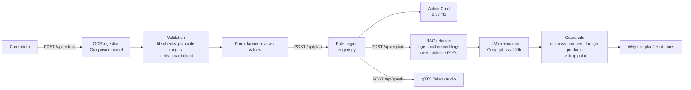

# Nela Mitra (నేల మిత్ర): Soil Health Card to action

Farmers in India get a government **Soil Health Card** full of numbers (pH 8.2, N 210, Zn 0.4) and no clear
instruction. Nela Mitra turns a photo of that card into a fertiliser shopping list in **Telugu or English**:
how many bags to buy, when to apply them, what changes from last season, the money saved, and a
**Listen** button for farmers who do not read comfortably.

**Design rule:** a deterministic rule engine computes every quantity. AI is used only to *read* the card
and to *explain* the plan, and guardrails stop it from inventing numbers or products.

## Architecture



| Layer | Where | What it does |
|---|---|---|
| OCR ingestion | `backend/app/ocr.py`, `extract.py` | JPG/PNG only, 8 MB limit, image verified, resized, sent to a Groq vision model as JSON-only |
| Validation | `backend/app/ocr.py`, `schemas.py` | Drops implausible readings (pH 45), reports missing values, refuses non-SHC documents |
| Rule engine | `engine.py` (shared with the Streamlit demo) | Ratings, crop doses, bag maths, soil fixes, schedule, last-season comparison, cost |
| RAG | `backend/app/rag/` | PDF to page-aware chunks, local ONNX embeddings, numpy cosine index, one-passage-per-topic retrieval |
| Explanation | `backend/app/explain.py` | Prompted to explain only; numeric and product guardrails; falls back to vetted templates |
| Audio | `backend/app/tts.py` | The whole card read aloud, with natural Telugu numbers ("రెండున్నర బస్తాలు") |
| Observability | `backend/app/logging_setup.py` | JSON logs, `x-request-id` on every response, latency for OCR, LLM and TTS |
| Web app | `frontend/` | React + TypeScript + Vite; UI strings come from the API, so both apps share one translation table |

### Why the guardrails exist (found in testing)

Early LLM output named **SSP** where the plan says MOP, called pH 8.2 "acidic", wrote nitrogen in ppm,
said "water test" for soil test, and claimed DAP was increased when the plan kept it the same. Each of
these is now caught, in English and Telugu:

1. **Numbers:** every number in a sentence must appear in the plan, the soil card or a cited source.
2. **Products:** any fertiliser not in the plan (SSP, complex, NPK and so on) drops the sentence.
3. **Soil facts:** a sentence is dropped if it calls alkaline soil acidic (or the reverse), gives N/P/K in
   ppm or mg/kg, or says "water" (నీటి) for soil.
4. **Actions:** a sentence is dropped if it says a fertiliser was increased or reduced when the plan did otherwise.
5. **Citations:** source ids that do not exist are removed.
6. **Telugu glossary:** the prompt pins farmer words and this soil's pH class (క్షార / ఆమ్ల).
   `LLM_TELUGU=0` switches Telugu to hand-written templates.
7. **Fallback:** if the LLM fails or every point is unsafe, rule-based explanations are returned
   (`generated_by: "rules"`).

Dropped sentences are logged as `explain.dropped_point`, with the reason.

## Run it locally

You need Python 3.9+ and Node 18+. Put `GROQ_API_KEY=gsk_...` in `.env` at the project root.

```bash
# backend
python3 -m pip install -r backend/requirements.txt
python3 -m backend.app.rag.ingest              # build the RAG index from docs/*.pdf (first run downloads ~130 MB model)
python3 -m uvicorn backend.app.main:app --reload --port 8000

# frontend (second terminal)
cd frontend && npm install && npm run dev      # http://localhost:5173
```

- API docs: http://localhost:8000/docs
- Production-style: `cd frontend && npm run build`. FastAPI then serves the app at http://localhost:8000.

### Docker

```bash
docker build -t nela-mitra .
docker run -p 8000:8000 -e GROQ_API_KEY=gsk_... nela-mitra
```

## Tests

```bash
python3 -m pytest          # 76 tests, offline: fake OCR, fake LLM, fake embedder
```

They cover rating boundaries, the dose maths from the spec, every crop in both languages, upload validation,
chunking and retrieval, every guardrail and the LLM fallbacks, and every endpoint's HTTP contract,
including 400, 422, 502 and 503 paths.

## API

| Method | Path | Body | Returns |
|---|---|---|---|
| GET | `/api/health` | | status, whether OCR and LLM are enabled, RAG chunk count |
| GET | `/api/meta` | | crops, seasons, samples, all UI text (EN/TE) |
| POST | `/api/extract` | multipart `file` | `is_soil_health_card`, values, missing, warnings |
| POST | `/api/plan` | `PlanRequest` | Action Card data |
| POST | `/api/explain` | `PlanRequest` | points with source ids, citations (doc, page, URL, snippet) |
| POST | `/api/speak` | `PlanRequest` | `audio/mpeg` |

`PlanRequest = {soil: {ph, ec, oc, n, p, k, zn, b}, crop, acres, season, last: {urea, dap, mop}, lang: "en"|"te"}`

## Guideline documents

The PDFs and their links are in [`docs/SOURCES.md`](docs/SOURCES.md): ICAR *Indian Farming* articles on rice
zinc and groundnut gypsum, a Ministry of Agriculture study on soil-test-based dosing in Andhra Pradesh, and
others. Drop more PDFs into `docs/` and re-run the ingest command.

> **Limits.** The doses in `engine.py` are illustrative and must be replaced with ANGRAU recommendations before
> real use. The documents ground the *explanations*, not the doses. Fertiliser prices are placeholders.

## Also in this repo

`app.py` is the original Streamlit demo (`python3 -m streamlit run app.py`). It uses the same `engine.py`.
`shc_sample_a.png` and `shc_sample_b.png` are demo Soil Health Cards marked SAMPLE.
